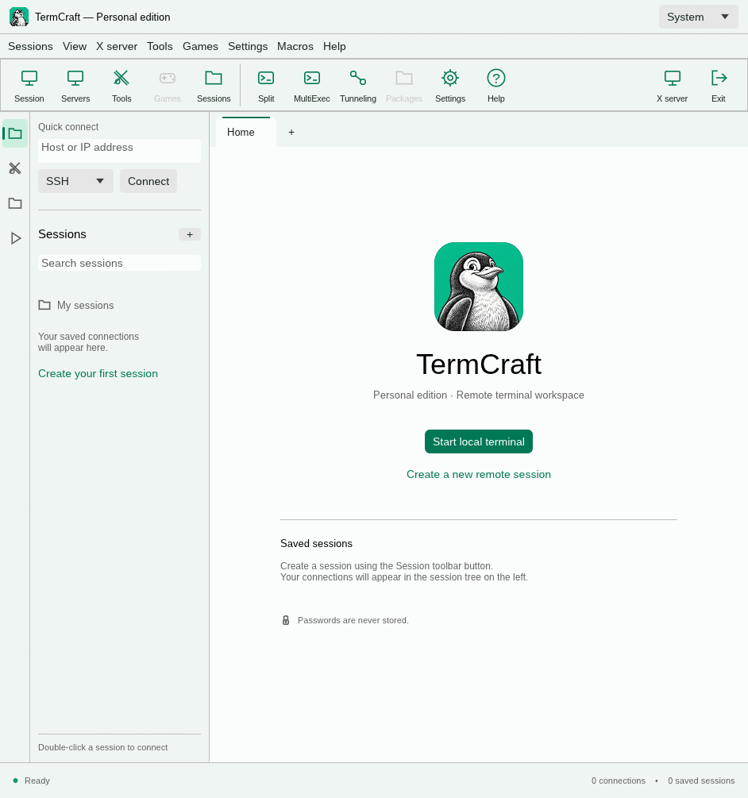

<p align="center">
  
</p>

<h1 align="center">TermCraft</h1>

<p align="center">
  <b>Local terminals, remote sessions, and file transfers in one desktop workspace.</b><br>
  Organize connections, work across terminal tabs, and keep everyday tools close.<br>
  Built in Rust with a Fluent-inspired interface.
</p>

<p align="center">
  
  
  
</p>

<p align="center">
  <b>Created with <a href="https://github.com/storytold/craft-anything">CraftAnything</a> by <a href="https://getartcraft.com/">ArtCraft</a>.</b><br>
  An independent remote workspace inspired by MobaXterm's organization and workflows.
</p>

<p align="center">
  <a href="#get-started"><b>Build and run</b></a> ·
  <a href="https://github.com/storytold/craft-anything">Craft Anything</a> ·
  <a href="https://getartcraft.com/">ArtCraft</a> ·
  <a href="https://getartcraft.com/apps">The Crafting Apps</a>
</p>

<p align="center">
  <picture>
    <source media="(prefers-color-scheme: dark)" srcset="shots/termcraft-dark.png">
    
  </picture>
  <br>
  <sub>The penguin-branded desktop workspace in light and dark appearances. System mode follows your desktop preference.</sub>
</p>

<p align="center">
  <a href="#features">Features</a> ·
  <a href="#get-started">Get started</a> ·
  <a href="#using-the-workspace">Using the workspace</a> ·
  <a href="#settings-and-storage">Storage</a> ·
  <a href="#development">Development</a> ·
  <a href="#status-and-compatibility">Status</a> ·
  <a href="#credits">Credits</a>
</p>

## Features

<table>
  <tr>
    <td width="33%" valign="top">
      <h3>Work in terminals</h3>
      Local shells and SSH sessions, terminal tabs, resizable two-column/two-row/four-pane layouts, search, output export, and logging. System, Light, and Dark modes also style terminal content.
    </td>
    <td width="33%" valign="top">
      <h3>Keep connections organized</h3>
      Saved sessions with folders, search, editing, duplication, and JSON import/export. SSH supports keys, jump hosts, compression, and trusted X11 forwarding.
    </td>
    <td width="33%" valign="top">
      <h3>Keep tools nearby</h3>
      Graphical remote files and editing, SSH tunnels, recorded and timed macros, diagnostics, managed services, and HTTP sharing with optional authenticated uploads.
    </td>
  </tr>
</table>

Terminal processes use real PTYs on Unix and a ConPTY adapter on Windows. The ANSI/VT screen supports common cursor, erase, scroll, truecolor, bracketed-paste, and alternate-screen operations; Unicode grapheme/wide cells and indexed search are covered by regression tests. History is bounded by both 360,000 lines and a visible 128 MiB budget; rich rows may reach the memory budget earlier. Real Linux PTY vim/less tests and an optional htop test exercise full-screen resize/restore; Negotiated SGR/legacy terminal mouse reporting is supported; hold Shift for GUI selection/scrolling. Mouse events stay local to their pane and are excluded from text macros. Terminal compatibility remains incomplete.

New SSH sessions use an embedded engine with an automatic remote directory pane and shared shell/SFTP authentication. Existing saved sessions retain their selected OpenSSH compatibility mode. Embedded sessions support direct and jump-host connections, explicit host-key trust, graphical file/folder transfers, remote editing with recovery, and an SCP compatibility option for SFTP-disabled POSIX endpoints with Python 3. The tested Linux workflows are described in the [execution evidence](PARITY_PROGRESS.md); native Windows/macOS and original-profile interoperability remain pending.

RDP and VNC have embedded workspace displays. Browser tabs use private profiles and pipes with an explicit bundled or installed Chromium choice. The pinned Linux bundle passes connection, app, sandbox and packaging checks; Windows and macOS providers remain source candidates awaiting native qualification. An optional pinned Linux Xwayland package supports app-owned displays and automatic per-session SSH forwarding. Mosh has an optional pinned Arch Linux x86_64 runtime with its own verified OpenSSH, Perl and native/module dependencies; the qualified closure requires glibc 2.44 and an OS shell. Compatibility choices remain visible rather than silently substituting installed programs. Linux XDMCP also supports explicit hostname resolution, optional bidirectional text clipboard sharing, single installed XKB keyboard layouts and an Indirect chooser. Feature sessions use a separately verified engine; IPv6, layout variants/groups and native platform qualification remain pending.

The Servers page manages app-owned FTP, TFTP, Telnet, SSH/SFTP, Iperf, Cron and NFS services, selected-display VNC sharing, and HTTP sharing. VNC clipboard and optional control are separately enabled; native platform coverage remains partial. The workspace includes SSH key/agent management, an encrypted credential vault, capture/diagnostics, pinned portable Unix packages, and an independently defined plugin workflow. Plugins require an explicit grant to run with the current account's access. Legacy ZIP/LZMA package inspection and inert quarantine import are available; imported original payloads are not registered or executed. Serial profiles expose line and flow-control settings. Platform and hardware coverage varies; consult the matrix before relying on a particular workflow.

The Games menu provides thirteen independently implemented card, arcade and puzzle games, with controls, help, reset and undo. Puzzle presets, custom settings, redo and explicit Solve are available; an optional idle screen preserves running terminal sessions. Further advanced variants, original gameplay equivalence and native desktop coverage remain in progress.

See the [feature-parity matrix](FEATURE_PARITY.md) for each capability's implementation status, dependencies, and remaining differences. Use the [prioritized parity checklist](PARITY_CHECKLIST.md) to track missing features, partial implementations, and validation work. The [complete implementation plan](docs/superpowers/plans/2026-11-23-complete-parity-plan.md) covers all 60 remaining points.

## Get started

### Requirements

- Rust 1.94 or newer, with Cargo and support for Rust edition 2024.
- A graphical desktop with working OpenGL drivers.
- Native compiler and platform development libraries required by eframe/egui and rfd. Linux builds use X11/Wayland support; file dialogs use the desktop portal.
- Installed dependencies for explicitly selected system/compatibility providers. SSH/SFTP, FTP/FTPS, Telnet/Rlogin/Rsh and VNC clients are embedded; release RDP uses its package-adjacent helper. Chromium, Mosh dependencies and optional X/runtime payloads have separate requirements.

Windows terminal support requires Windows 10 version 1809 or newer. Native Windows and macOS runtime behavior still needs validation; Linux has the strongest verification coverage.

### Build from source

Run these commands from the `app/` directory containing `Cargo.toml`:

```sh
./scripts/build-release.sh
./target/release/harbor-workspace
```

The first build downloads dependencies. Once Cargo has cached them, add `--offline` to build or run without network access:

```sh
TERMCRAFT_OFFLINE=1 ./scripts/run-dev.sh
```

For the latest development app, run `./scripts/run-dev.sh`. It builds the headless RDP helper and the GUI. Embedded RDP uses an independently locked helper package to keep its protocol/crypto dependencies compatible with the SSH engine; frames and sign-in responses use owned private pipes. Keep `termcraft-rdp-engine` beside the release executable when copying a release build. On Windows, build `engines/rdp/Cargo.toml` and the app with Cargo, then copy `termcraft-rdp-engine.exe` beside `harbor-workspace.exe`. Native Windows/macOS validation remains pending.

Embedded RDP folder mappings are configured in the session editor and default to read only. Writable mappings support file creation, overwrites and resizing; rename, deletion, allocation and save-through-temporary-rename workflows remain unavailable. Only explicitly selected folders are exposed. Printer, serial-port and smartcard embedded providers remain unfinished. Administrative mode requests session zero, with native Windows behavior still awaiting endpoint validation. Current tests and the host-validation command are documented in `docs/parity-evidence/D02/providers/README.md`.

The release executable is `target/release/harbor-workspace` on Linux and macOS, or `target/release/harbor-workspace.exe` on Windows. The internal binary name is retained for compatibility; the application is named TermCraft.

This project currently documents source builds. Installer, AppImage, and signed application bundle workflows are not provided here.

### Your first session

Drag to select terminal cells; **Alt-drag** selects a rectangle. **Ctrl+Shift+C/V** copy/paste. Clipboard settings include copy-on-select, word delimiters and right-click paste; **Shift-right-click** keeps the menu reachable.

GUI clipboard reads stay bound to the original terminal targets while running in the background. On Wayland, the optional `wl-paste` helper is preferred; native provider errors are reported and keyboard paste remains available.

Multiline paste and closing active sessions ask for confirmation by default. Settings also offers a per-line paste delay. Broadcast paste confirms its original targets together; Cancel sends no paste payload. A running paste can cancel its remaining input.

Configure font, size, light/dark palettes, encoding, Backspace and fixed/dynamic dimensions in **Settings → Configure global terminal profile**. Sessions and open tabs can override individual values or reset to global. Supported encodings are UTF-8, Windows-1252 and Shift_JIS; changes affect future input/output while preserving raw logs and retained text.

Configure keyword colors and bounded literal/regular-expression rules in **Settings → Configure terminal highlighting**. Saved sessions and open tabs can inherit, enable or disable them; search and selection take visual priority.

1. Choose **Start local terminal** on the home screen to open your default shell.
2. Choose **Create a new remote session** to configure and save a connection.
3. Double-click a saved session in the sidebar to connect.
4. Right-click a saved SSH session to open a companion SFTP tab with the same connection options.

Install `ssh` and `sftp` on `PATH` for OpenSSH compatibility mode and standalone SFTP tabs. New embedded SSH sessions use the in-process engine. If a required client is missing, TermCraft reports the dependency and keeps the session settings so you can reconnect later.

## Using the workspace

- **Sessions:** use the Sessions toolbar button or **Ctrl+Shift+B** to show or hide the session pane. Drag its edge to resize it; width and visibility persist.
- **Import sessions:** choose **Sessions → Import MobaXterm/PuTTY** to preview supported SSH definitions before applying them. Moba bookmark INI/documented CSV and PuTTY Registry exports are supported with explicit unsupported-field warnings and duplicate policies. Credentials and source commands are excluded; original/native format validation is still pending.
- **Terminals:** open multiple tabs, choose resizable two-column, two-row, or four-pane layouts, detach/reattach tabs through their context menu, rename them, search output, or export and log a session. MultiExec lets you select connected targets, view them in paged four-pane layouts, and broadcast accepted keyboard input or confirmed paste. Newly opened tabs stay excluded; failed targets are reported. Configure application and terminal-history shortcuts under **View → Keyboard shortcuts**. Inactive tabs show **new output** separately from running/error status.
- **Transfers:** use the embedded remote pane for file/folder upload and download, explicit overwrite conflicts, progress and cancellation. Drop local items onto its upload zone, or drag remote entries onto the chosen local download folder. Standalone companion SFTP tabs may authenticate again.
- **Remote folders:** enable **Follow shell directory changes** to follow OSC 7 notices. Expand **Shell setup** to copy reversible Bash, Zsh or Fish setup; paste it into that SSH shell intentionally. Without compatible notices, use the manual folder field.
- **Remote editing:** double-click a regular file in the remote pane to edit UTF-8 text up to 2 MiB. Save writes a local recovery snapshot before uploading. A changed remote version produces a conflict with an explicit replacement choice; closing dirty documents offers Save, Discard or Cancel.
- **Files:** browse and edit local text files, copy files without overwriting an existing destination, rename items, and delete files or empty directories.
- **Tunnels and tools:** configure local, remote, or dynamic SSH forwarding; use DNS lookup, ping, SSH-port checks, and SSH-key generation.
- **Appearance:** select **System**, **Light**, or **Dark** from the title bar or Settings. The penguin logo and emerald accents carry through both palettes. System mode follows the native desktop theme; on Linux it reads the desktop appearance portal every two seconds and defaults to light when no preference is available.

The remote pane supports directory navigation, mkdir/rename, confirmed deletion and staged transfers. Explicit folder overwrite merges complete files while preserving unrelated entries; cancellation or failure can leave earlier files completed and retains remaining staging data. Absolute and parent-relative symlink targets are refused. Directory following and remote editing have Linux implementation tests; native GUI and Windows/macOS validation remain pending. Remote documents stay bound to their opening SSH connection. After reconnecting, choose **Compare recovery in active SSH session** from the retained editor. Matching authenticated usernames, endpoints and verified target/gateway keys permit importing your text into a successfully opened document without unsaved destination edits; Save remains a separate action. SFTP checks for remote changes before and after staging, but cannot prevent another writer racing the final rename.

Use **Sessions → Shared session sources** to add a local file, HTTPS endpoint, or SFTP file through a saved embedded SSH profile. Shared entries are read-only; refresh updates their source group, while **Copy to local** creates an independent saved session. Offline entries keep a labeled stale cache. HTTPS supports private Basic sign-in; SFTP shares the SSH host-key/authentication flow. Source commands and local resources require review before launch. No source password is saved automatically.

Right-click a saved-session folder to launch it and its subfolders; a results window reports immediate failures while valid peers connect independently. Session and folder menus can save launch shortcuts. Linux `.desktop` entries are tested through the desktop launcher; Windows `.lnk` and macOS `.command` shortcuts still need native validation. Existing shortcut files are never overwritten.

CLI actions include `--session <stable-id>`, `--group <folder>`, `--new-tab`, `--command <text>`, `--macro <name>`, and local `--cwd <directory>`. Use `--data-dir` for an isolated workspace. Requests for an already running workspace are acknowledged after queuing; connection results appear in its tabs. Commands and macros create their own target terminal. `--exit-when-done` closes those terminals when their processes finish and preserves existing user terminals. Run `--help` for all options.

Use **Sessions → SSH keys and agents** (also available in Tools) to create a new key bundle, inspect/import a private key, copy its public key, or manage agent identities. A bundle contains `private_key` and `public_key.pub`; existing destinations are never replaced. Generation supports Ed25519, ECDSA and RSA, with an optional passphrase. Protected OpenSSH imports keep their ciphertext; recognized PPK keys can be converted while retaining protection. The manager rejects oversized/high-cost key inputs and encrypted PKCS#8 conversion is currently unavailable.

Start a **TermCraft-owned** agent explicitly, add an identity with an optional lifetime, and choose it in an embedded SSH session's agent setting. Source-only SFTP uses that same selection. System agents remain borrowed and are never stopped by TermCraft. An explicit key file takes precedence; **Disabled** prevents agent use. Owned/Pageant selection is unavailable in installed-client compatibility mode. Windows/macOS agent UI/service/Pageant behavior still needs native validation.

## Settings and storage

Sessions, tunnels, macros, and preferences are saved locally as JSON. Existing Harbor configuration paths are retained so earlier workspaces continue to load:

| Platform | Default configuration directory |
| --- | --- |
| Linux | `$XDG_CONFIG_HOME/harbor`, or `~/.config/harbor` |
| macOS | `~/Library/Application Support/Harbor` |
| Windows | `%LOCALAPPDATA%\Harbor`, with the user profile as fallback |

Remote editor recovery snapshots are retained under `remote-recovery/` inside the settings directory. The editor displays the exact local path. Closing or discarding a document keeps these snapshots; remove copies when you no longer need them.

Choose an independent settings directory with:

```sh
cargo run -- --data-dir ./my-workspace
```

Passwords are not saved by default. Choose **Sessions → Credential vault** to create or unlock an encrypted vault, then select **Save entered value in vault** on an eligible SSH/password, key-passphrase, or shared HTTPS sign-in prompt. Unlock the vault before choosing to save. **Use saved credential** fills a matching prompt and requires you to continue explicitly. Trust, username, and keyboard-interactive/OTP prompts are excluded. The manager supports locking, changing the master password and deleting entries; locking/deletion clear corresponding vault-filled fields. Only opaque references enter workspace JSON. Native Windows/macOS vault UI/ACL and power-loss validation remain pending. Embedded SSH presents its own authentication prompts and checks user/app host-trust stores. OpenSSH compatibility uses your installed client configuration. Text macro recording captures typed input, so stop recording before entering secrets. Damaged settings files are preserved until an explicit backup/reset action.

Screenshot runs use the isolated `data/screenshot/` directory unless `--data-dir` overrides it.

## Development

### Build and test

```sh
cargo build --offline
cargo test --offline
```

The Linux suite covers terminal/PTY behavior, settings, rendering, isolated OpenSSH shell/SFTP operations, shared authentication, file jobs, path/host policy, cancellation, and injected staging write/sync/close failures. Integration tests require `sshd`, `ssh-keygen`, and a C compiler for the process-scoped fault shim; they do not alter your SSH service or configuration.

The pre-embedded Windows baseline passed `cargo check`; the current whole-app cross-check needs Windows SDK headers unavailable on this host. The current Windows filesystem primitives/backend cross-check separately. Native Windows/macOS execution, wider server interoperability and serial hardware remain unverified.

### Capture the interface

With a working display and OpenGL context:

```sh
cargo run --offline -- --screenshot shots/now.png
```

Screenshot mode opens an inactive window, draws 120 frames, saves a PNG, and exits. On Windows the window stays behind other windows; on macOS app activation is disabled. Capture mode requests continuous redraw while rendering.

### Find your way around

| Path | Purpose |
| --- | --- |
| `src/branding.rs` | Shared penguin logo for the window icon and workspace |
| `src/ui/appearance.rs` | Background Linux desktop theme detection |
| `src/model.rs` | Session types, preferences, validation, and JSON persistence |
| `src/connection.rs` | Protocol client selection and launch arguments |
| `src/terminal.rs` | Streaming terminal screen and escape-sequence handling |
| `src/process_unix.rs`, `src/process_windows.rs` | PTY/ConPTY processes and lifecycle management |
| `src/serial.rs`, `src/http_server.rs` | Serial transport and HTTP file sharing |
| `src/ui.rs`, `src/ui/` | Workspace, pages, dialogs, and terminal rendering |
| `tests/` | Connection and model integration tests |

For more context, read the [design notes](DESIGN.md), [implementation plan](PLAN.md), and [mechanics mapping](MECHANICS.md).

## Status and compatibility

**TermCraft is a prototype. Full MobaXterm feature parity remains the target and has not been achieved.** Successful builds, tests, and screenshots establish a working foundation; they do not prove equivalent behavior.

Major unfinished areas include:

- Native/original terminal conformance and broader endpoint/format validation beyond the current regression fixtures.
- Remaining remote desktop options and device redirection; embedded VNC, browser/X server scope, and complete XDMCP integration.
- Native validation of implemented SSH/SFTP/SCP browsing, editing, imports and session management.
- Native validation and remaining format coverage for the password vault and agent manager; graphical macros, plugins, and package management.
- Native VNC/server qualification, real compositor permissions, original service comparison, and unresolved Personal FTPS exposure.
- Remaining game variants and original gameplay/screensaver comparison; native qualification of Windows integrations.

Linux build, test, and screenshot checks have passed. Windows and macOS require native validation. Original-app appearance and mechanics have not been verified through runtime comparison, and estimated defaults remain labeled in the documentation.

The [feature-parity matrix](FEATURE_PARITY.md), also available under **Help → Feature parity and known differences**, records the remaining scope and evidence needed for completion.

## Credits

TermCraft uses Rust, eframe/egui, and the libraries recorded in `Cargo.lock`. Interface symbols are drawn in code; bundled interface and terminal fonts have license files alongside their assets. Installed protocol clients are separate programs with their own licenses.

See [CREDITS.md](CREDITS.md) for dependency and font acknowledgments. This directory does not currently include a top-level project license; dependency licenses do not establish a license for TermCraft itself.

MobaXterm and other product names belong to their respective owners. TermCraft is independently implemented and is not affiliated with or endorsed by the original product's owners.

### Linux and macOS desktop launch integration

Linux release packages include `desktop-integration.py install|status|uninstall`.
Run it with Python 3 from the extracted package. Install copies the packaged
application, adjacent helpers, runtime manifests and penguin icon into
`${XDG_DATA_HOME:-$HOME/.local/share}/termcraft/desktop`, then registers a menu
entry, optional directory “Open With TermCraft” handler, open-here action and
bookmark MIME/URL handlers. The installed copy keeps working after the extracted
archive moves or is deleted. Run install from the new release to upgrade; close
TermCraft first. Workspace settings remain in their existing configuration
location. Removal checks owned-file hashes and refuses to remove user-modified
entries. It preserves unrelated files and user default associations.

macOS packages use a native AppKit launcher for Finder URL/file events and the
Finder Services “TermCraft/Open terminal here” action. It forwards literal
arguments to the adjacent Rust application; the Rust executable and RDP helper
remain beside each other. Bundle-relative paths survive moving the `.app`.
Optional explicit registration, status and removal use Python 3:
`python3 TermCraft.app/Contents/Resources/desktop-integration.py install|status|uninstall`.
Registration records only owned bundle paths, supports registering a moved/new
bundle, and never chooses a default application. Finder Services may need to be
enabled in macOS Keyboard settings. Native event delivery and Services execution
still require validation on a Mac; Linux checks only declarations/source/layout.

Desktop URLs accept only `termcraft://session/<percent-encoded-stable-ID>` or
`termcraft://cwd?path=<percent-encoded-absolute-directory>`. A `.termcraft-link`
file is UTF-8 JSON, at most 16 KiB, containing exactly `{"version":1,"session":"ID"}`
or `{"version":1,"cwd":"/absolute/directory"}`. Missing bookmark IDs produce the
normal workspace launch error. `--open-url` and `--open-file` use the normal
workspace/IPC dispatcher, preserve an explicit `--data-dir`, and reject additional
terminal actions, unknown fields, commands, credentials and workspace overrides.
