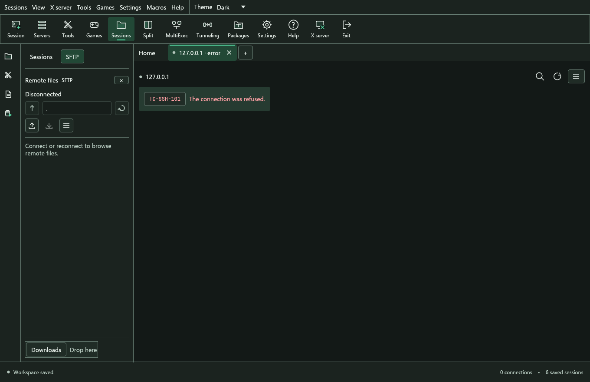
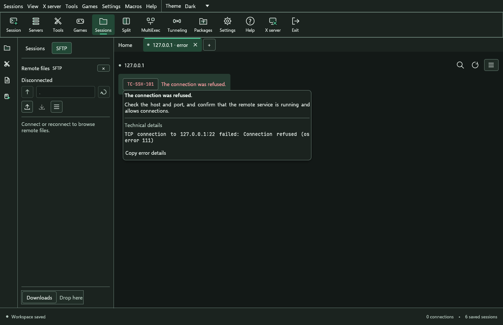
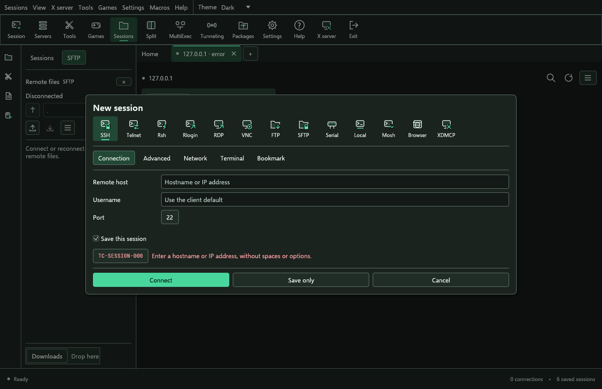

# Error message native checks

Actual SSH connection refusal on an isolated local display, its error-code/details popup and session form validation. All screenshots are unaltered native captures; bookmarks are synthetic. [Source and image hashes](manifest.json). The development binary uses a freshly rebuilt current library with the documented pre-adapter GUI dependency cache. Full platform/package qualification and owner human acceptance are separate.

