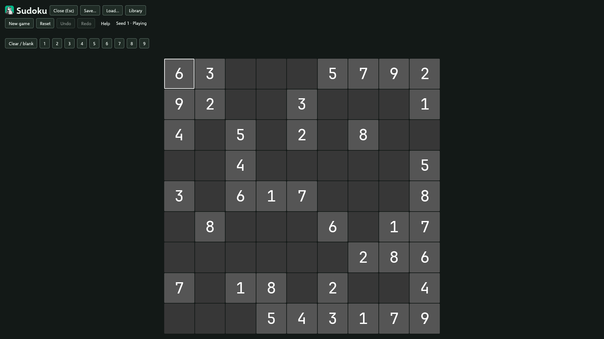
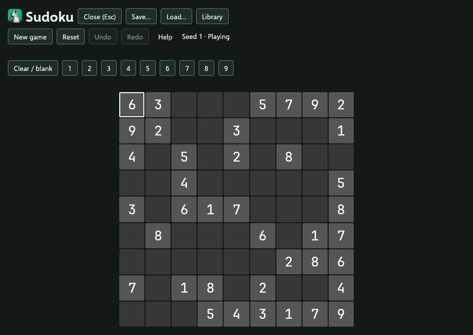
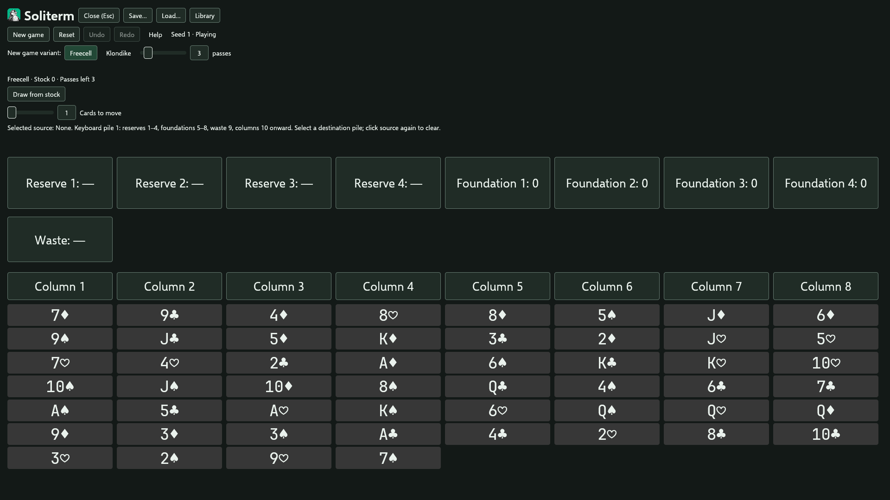
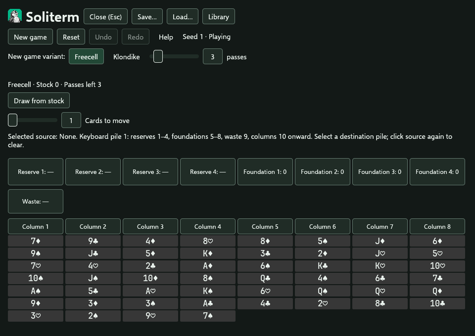
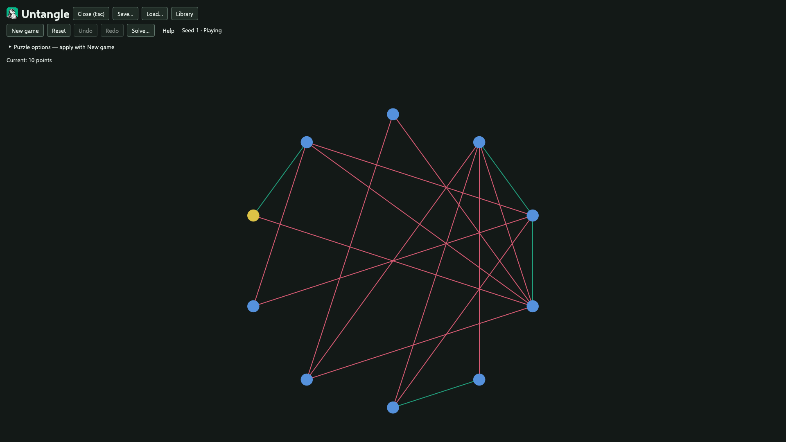

# Native game layout previews

Actual Linux native windows with synthetic review data, at 1920 × 1080 and 960 × 680. These images show the owner-requested centered, proportional game boards; no artwork or compositing was used. They are game-layout evidence, not human acceptance or remote-desktop qualification.

