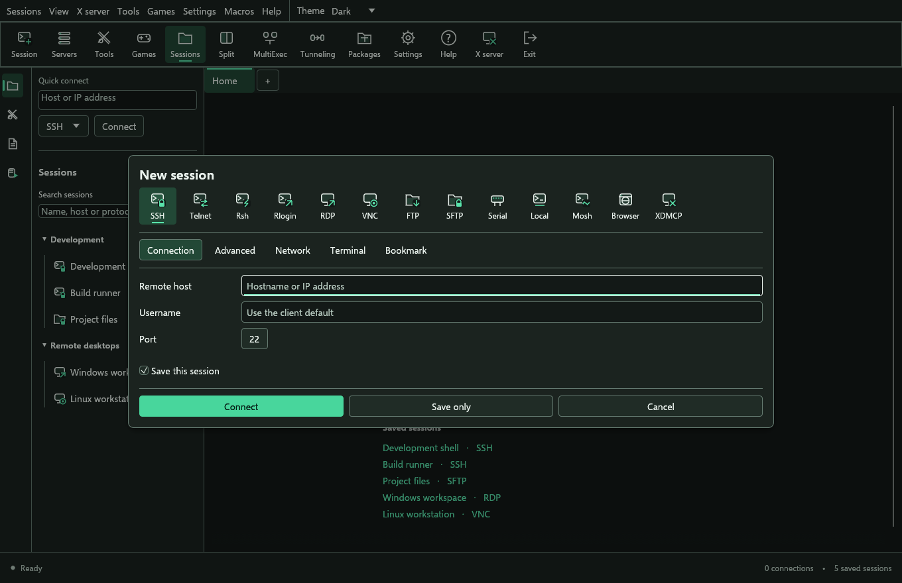
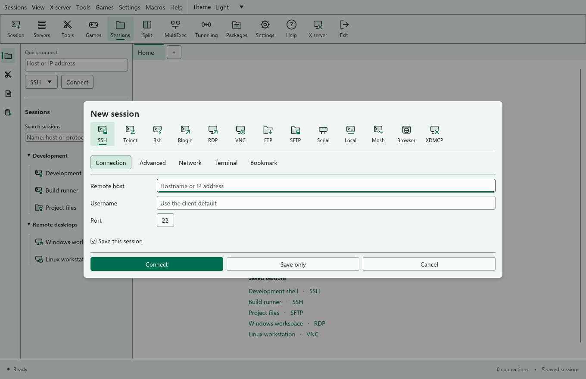

# Session protocol icons

Owner-requested correction: all thirteen selector buttons use distinct original themed glyphs. Existing dialog layout, labels, selection behavior, forms and footer stay intact. Native development renders use sample bookmarks and the documented cached pre-adapter dependencies. [Source and image hashes](manifest.json).

