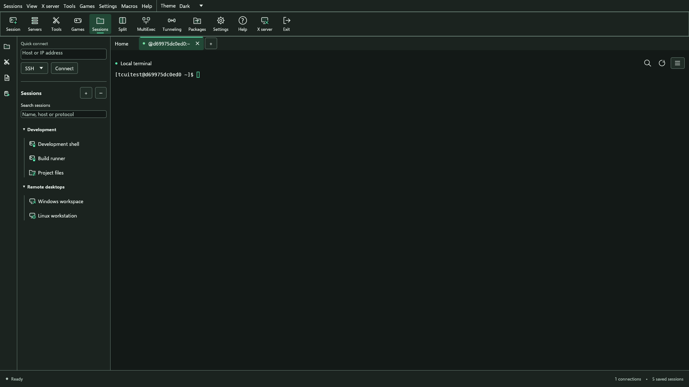
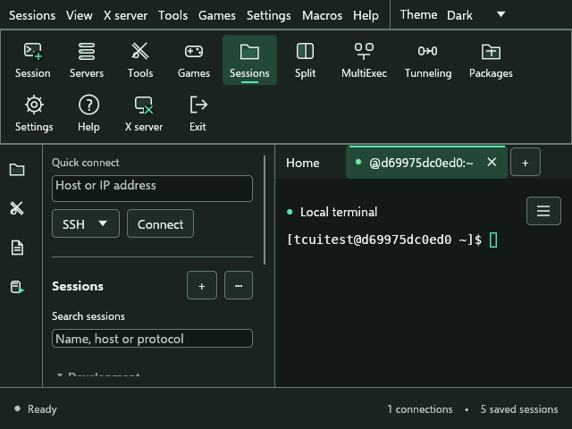

# Terminal control row correction

App menus, toolbar and tabs are separate again. Only terminal controls share one compact row. Native renders at 1920×1080 and 640×480; bookmarks are sample data and the terminal is a real local PTY. The development binary uses verified cached pre-adapter dependencies. These are UI previews, not production package or owner acceptance evidence. See [source and image hashes](manifest.json).

