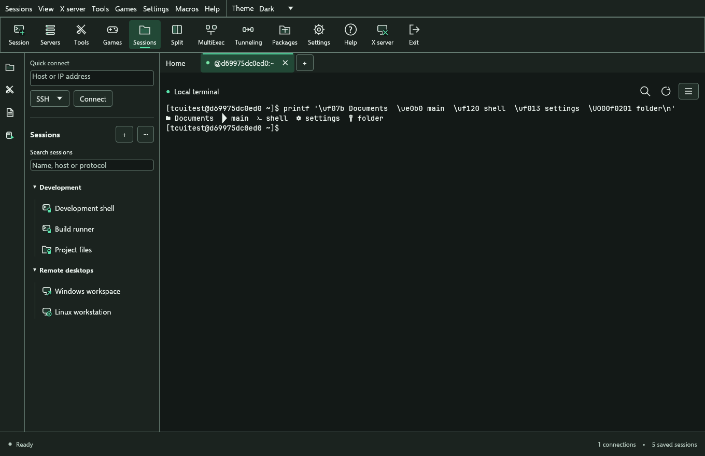

# Terminal font and cursor correction

The native local terminal renders fixed-width Nerd Font/Powerline symbol fixtures. Eight timed native captures alternate between visible and hidden cursor phases; the only changing image bounds are the cursor rectangle `(547,238)–(555,255)`. Full-frame examples are retained unaltered. Bookmarks are synthetic. The GUI dependencies use the documented pre-adapter cache; the application library was rebuilt from current source. These are development UI checks, not production-package or live-SSH qualification. [Source, font and image hashes](manifest.json).

[Visible cursor](cursor-on.png) · [Hidden cursor](cursor-off.png)
