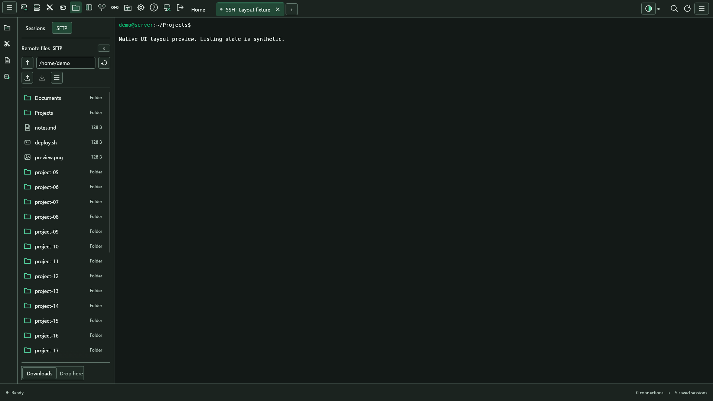
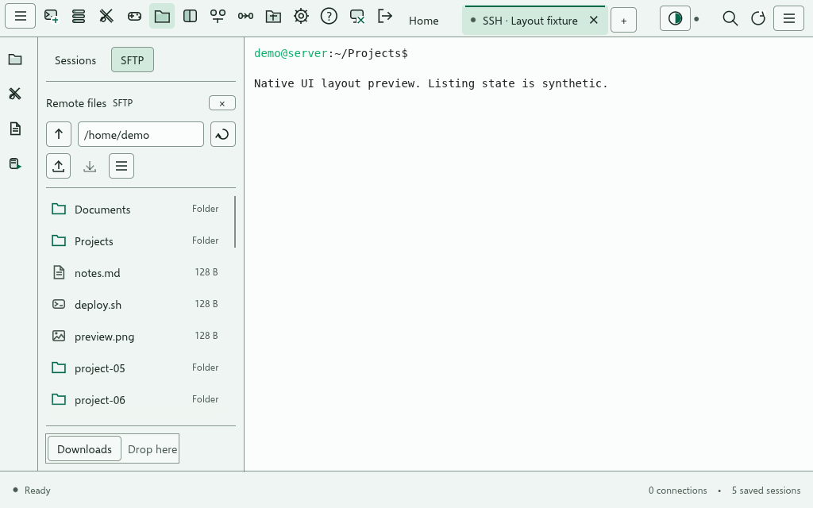
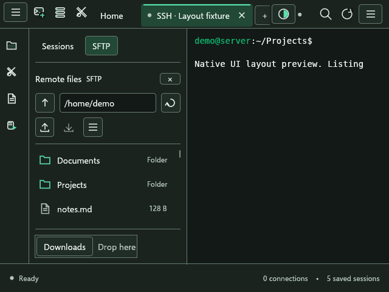

# Combined bar and shared-sidebar native previews

Source `05a2234`. These are actual native application pixels on an isolated X display, with verified cached dependencies. The SSH views explicitly use synthetic listing state; they demonstrate layout rather than a live connection. See [source identities, hashes and limits](manifest.json). Hosted package qualification is separate. Owner human acceptance remains pending.

| View | Native image |
| --- | --- |
| Home | [Dark](home-dark-fhd.png), [Light](home-light-fhd.png) |
| Network tools | [Dark](tools-dark-fhd.png) |
| Input and safety settings | [Dark](settings-dark-fhd.png) |
| SFTP sidebar | [Dark full HD](ssh-dark-fhd.png), [Light full HD](ssh-light-fhd.png) |
| Short window | [Dark](ssh-dark-short.png), [Light](ssh-light-short.png) |
| Minimum window | [640×480](ssh-dark-minimum.png) |
| Sessions tab beside the same terminal | [Dark](sessions-tab-dark-fhd.png) |
| Remote actions on demand | [Dark](ssh-actions-dark-short.png) |
