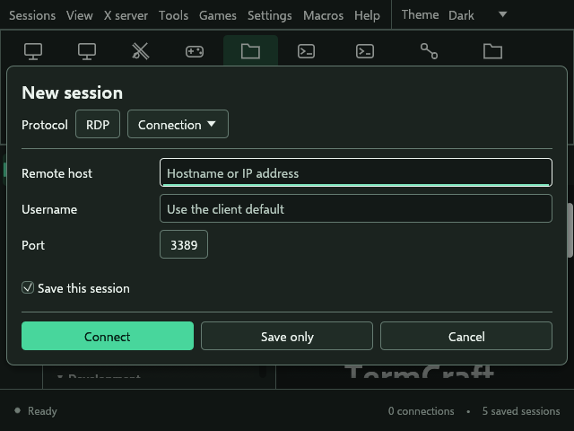

# Human-review correction — 2026-11-27

The owner rejected the prior c2 UI as cluttered/inconsistent. Prior passing tests remain historical technical evidence, NOT human acceptance. PR8 draft; NEVER merge until explicit human approval. Scope is authorized continuation, no new permission milestones.

## Reference and correction design
Actual MobaXterm session screenshot inspected by controller: target/issue-4/references/mobaxterm-session.png (NeSI https://docs.nesi.org.nz/Getting_Started/Accessing_the_HPCs/MobaXterm_Setup_Windows/). Protocol icons, compact host/username/port basics, advanced/terminal/network/bookmark tabs. Official https://mobaxterm.mobatek.net/documentation.html corroborates fields. Do not copy outdated Windows visual style: preserve Windows11 Fluent styling, green logo accent.

Six owner screenshots under /tmp/codex-clipboard-{73ce984b-e9e5-43a2-a61f-5b7d169dbfd6,2b5fb081-295f-4e78-8e8b-1bdab1875c45,68603fef-91db-4f37-ab46-dbe9f5c3c891,b3a7aad2-2b49-4887-bc5e-c818e2a75b62,f27375d0-00e9-4e92-b074-ce6b0952da5c,87044118-55d8-4015-a4ef-a7012c4d8c75}.png.

C1 Session creation: default simple essentials first, protocol chooser with existing icons; advanced/terminal/network/bookmark or appropriate protocol tabs. No name/folder or dozens of advanced options crowding default page. All existing options remain reachable, values preserved across tabs, fixed Connect/Save only/Cancel footer. SSH and RDP defaults should fit without body scroll at ordinary desktop dimensions. RDP security/display/clipboard/redirection organized, prose replaced by accessible help on demand. No auth/default/storage/network changes. Safety warnings remain at relevant decision.
C2 Main workspace: terminal gets one compact action row; move always-visible profile/highlight/split-layout/history diagnostics into appropriate More/settings popup. MultiExec only when activated, retain explicit targets/safety. Preserve pane identity/focus with less decoration for sole pane. Sidebar quickconnect/search/tree, one empty state, shared sources manager and keyboard instructions in overflow/help rather than permanent text blocks.
C3 Page layout: vertical scrollbar at right edge of its own full-width viewport, dedicated gutter with no content overlap. Readable content cap INSIDE full-width viewport, not enclosing ScrollArea natural-width shrink. Settings category navigation/equal-width organization and concise help. Games fills whole client background, responsive launcher grid rather than narrow 13-button column. Detached window compact reattach/overflow actions, native title for identity, history hidden by default. No changes to game logic, dirty guards, terminal renderer, identifiers, trust, credential storage.

## Status

- [x] Simplify session creation and contextual help.
- [x] Compact terminal, sidebar and detached controls.
- [x] Correct full viewport scrolling, settings and games layouts.
- [x] Inspect real native previews at normal, ultrawide and compact sizes.
- [x] Pass focused regression checks and independent review.
- [ ] Produce updated human-check builds.
- [ ] Owner completes human checks; merging remains prohibited.

## Current native development previews

Correction source: `72db3f4078af03cca728a1853387165875a20dc2`. [Eight original captures and source/binary identity](captures/human-correction/manifest.json) record the actual running development UI at Full HD, ultrawide, compact and detached sizes. These use a source-verified cached library with prior native-adapter dependencies. They are not packaged-build, physical hardware, screen-reader or owner acceptance evidence. The prior c2 packages do not contain these corrections.

The controller directly inspected the simple SSH/RDP pages, full-width scroll viewport, categorized settings, compact terminal, detached controls and centered games catalog. During that inspection, the first games layout and clipped compact RDP port were returned and corrected. Independent review approved the correction and the final legacy-protocol guidance fix. The source `72db3f4` passed 74 focused cases; the six-line wording correction `8c50a01` passed seven covering cases. These case sets overlap. Current-source hosted CI and updated distribution packages remain pending.

## Earlier native development preview

Source `8c50a010f8aeb96cfc03ff2e5d6fc672b40241ff` incorporates the independent review's final wording correction. The local native development executable is `target/issue-4/specialist-probe/termcraft-human-review-ready`, SHA-256 `79e0988509923ef4809e0cc7e82d054077fd6174be451d8bc732289c907363bb`. This is a UI review preview with the development dependency limits above; it is not a replacement for current-source platform CI or distribution qualification. PR #8 remains draft and unmerged. Owner acceptance is still open.

## Full CI read-only-state correction

The first full Linux run at `e8347a2` found one missed UI case: the simplified shared-session heading no longer explicitly said read-only. That application target reported 274 passed, one failed and eight ignored. The CI/package runs at that head were cancelled and are not accepted replacement builds.

Source `6e58b3c397313eb8c1aba49a8b0493f733ca1652` restores the concise “Shared sessions · read-only” heading. The test checks read-only, source name, cached/stale state and the shared session's name. The missing state was reproduced before the fix; nine covering cases passed after it, including shared-source cache/restart/no-overwrite and canceled credential/prompt guards. This set overlaps earlier focused checks. Current-source full CI and unsigned packages are being rerun after scoped review; owner acceptance remains open.

## Scheduler fixture synchronization

The corrected application's full native CI at `9c6f10c` passed on Linux, Windows x64 and Apple Silicon: [run 46037789416](https://github.com/asad-albadi/TermCraft/actions/runs/46037789416). The duplicate Linux regression in the package workflow separately hit a pre-existing scheduler-test race; all 275 application UI cases passed there too.

Test-only commit `abd621e` waits for the scheduler's published job status as well as the four child-process markers before asserting exactly two process-limit skips. It preserves the original one-second service lifetime, stopped-state, file-content and log-bound checks. Production scheduler and application code are unchanged. The updated fixture passed 30 scoped runs; the baseline also passed 30 locally, so the package CI log remains the observed failure. Scoped independent review approved the correction. Fresh full CI verifies the test-only commit.

The unsigned native packages being built at `9c6f10c` contain every production/UI correction. They remain identified by that exact source revision; a subsequent test-only change does not relabel their identity. No failed aggregate run is described as green, and no release or merge is authorized.
